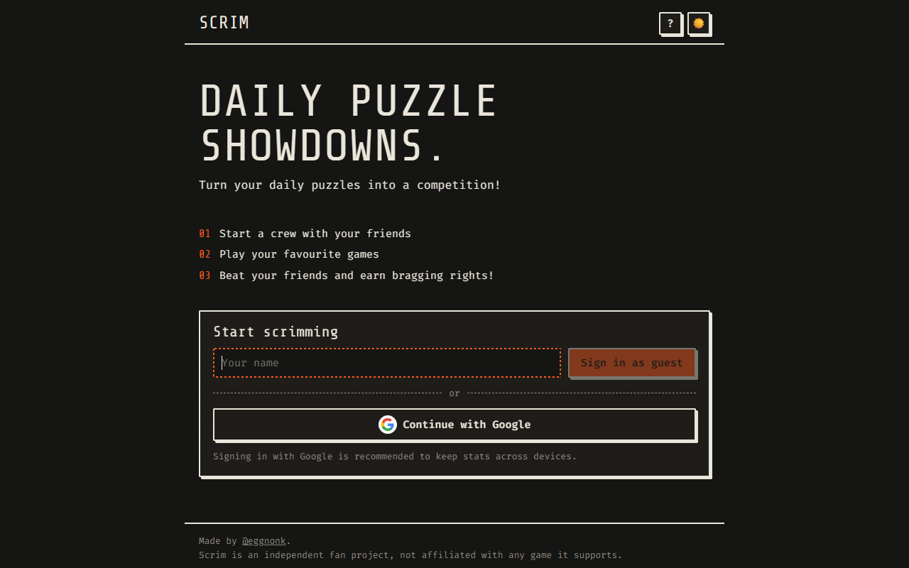
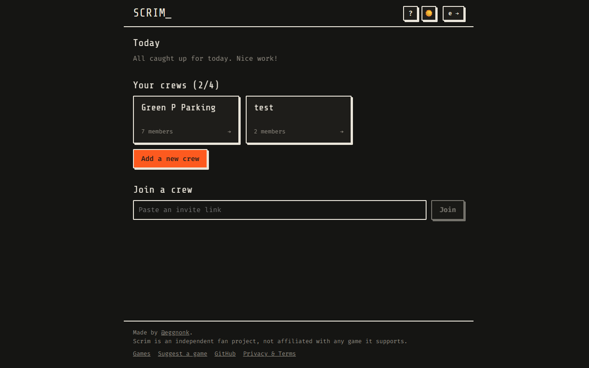
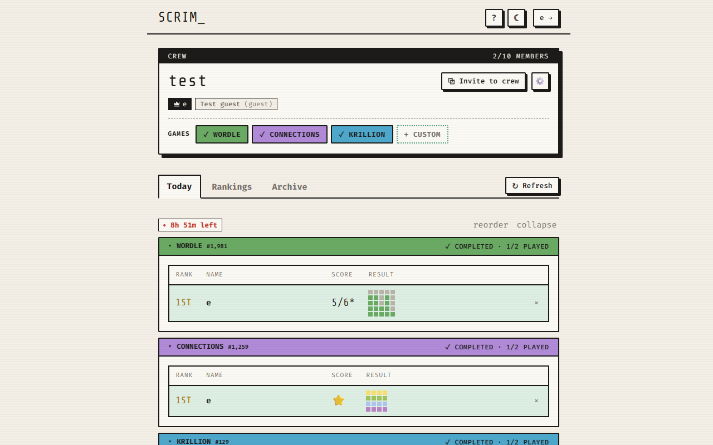
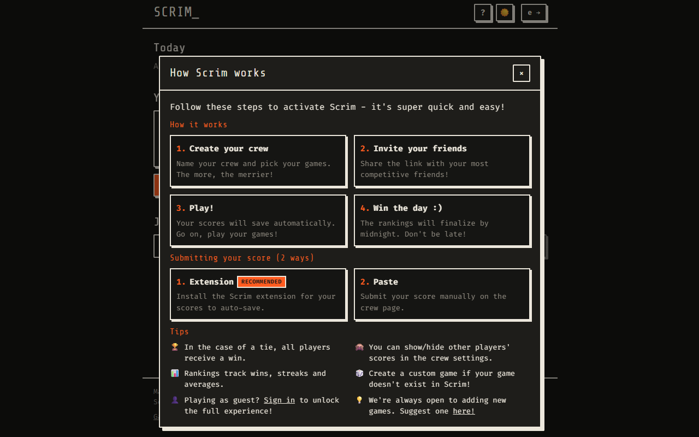
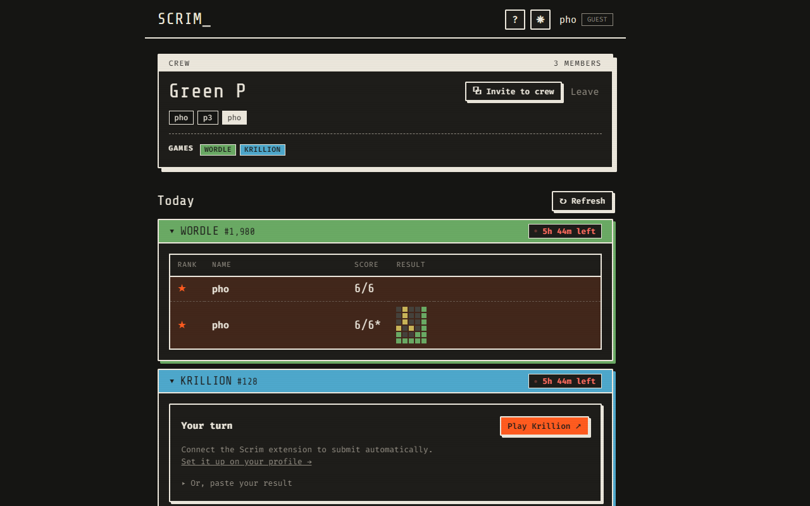

# Scrim

Daily puzzle showdowns with friends. Start a crew, pick the games it plays and
share the invite. Everyone plays each day's puzzle on their own time, each day
crowns a winner, and the crew keeps rankings and every past day.

**Games:** Wordle, NYT Connections, NYT Strands, Krillion, Contexto, Costcodle (Checkout and Classic),
Poople, the Mini Crossword (Easy and Hard), Worldle, Globle, Waffle (daily), Nerdle (classic), Perceptle,
Minecraftdle (Block, Item and Mob dailies) and Angledle (the daily Guess),
today's puzzle only. Desktop
Chrome only. Only free-to-play games are supported (`GameAdapter.free` is typed
`true`).

Results get in automatically through the **Scrim Chrome extension**: play the
game on its own site as usual, and when you finish, the extension reads the
result from the page and submits it to every crew you're in that plays that
game. Pasting the game's share text is the fallback; scores can't be typed in.

## Screenshots

| | |
|---|---|
|  |  |
| **Landing page.** Sign in as a guest or with Google. | **Home.** What's left to play today, your crews, and joining one by invite link. |
|  |  |
| **A crew.** Its members and games, then each game's scoreboard for today. | **How Scrim works.** The guide behind the ? button. |

*A crew's Today tab in dark mode.*

## How it works

| Concept | Lifetime | Notes |
|---|---|---|
| **Crew** | permanent | Friend group. The owner picks its games, time zone and spoiler setting. Rankings and past days. Link: `/crew/<code>` |
| **Round** | one crew, one game, one puzzle | Nobody creates it: the first result for that puzzle starts it. Closes at midnight in the crew's time zone (New York time for Krillion, UTC−8 for Poople, UTC for Waffle and Nerdle, Madrid time for Minecraftdle) |
| **Entry** | one per player per round | Validated server-side. Source is `extension`, or `paste` as the fallback |

- **Joining:** opening a crew's invite link joins it, unless someone in the
  crew already has your display name (ignoring case); renaming yourself to a
  name taken in one of your crews is refused too. Members can leave; the
  owner can remove members, which also bans them from rejoining.
- **Games:** the owner turns games on and off right in the crew box on the
  crew page. Turning one off keeps its past days and rankings.
- **Time zone:** a new crew takes its creator's time zone. Crews from before
  time zones existed get the owner's the next time they open the crew page.
  The owner can change it under ⚙ Manage crew.
- **Custom games:** for daily games Scrim doesn't integrate, the owner adds
  a custom game (crew box → "+ Custom"): name, link, instructions, colour,
  score type (points, time or attempts) and its format, which way wins, and
  whether "didn't finish" is allowed. Scores are typed in by hand, on the
  honour system. Scoring locks once anyone has entered a score. The owner
  edits or deletes one from its card under Today (✎); deleting also
  removes its scores and past days.
- **Guests:** a guest account exists only in the browser that made it, so
  it's lost by signing out, switching devices or clearing site data. It
  stays in the crews it joins until it's been inactive for 48 hours (no
  score, no crew joined): then it's taken out of them, keeping its finished
  days in the archive but dropping out of the rankings (0025). Guests can't make
  crews: they join someone else's with an invite link (opened, or pasted on
  the home page). Linking Google makes it a regular account. Guests show as
  "(guest)" in the crew box, scoreboards, rankings and archive. Rankings count
  current members only, so anyone who leaves or is removed drops out of them. They can't suggest
  games, and a crew owner can turn guest joins off. A guest account with
  nothing left (no crews, no scores) is deleted a day after it was made
  (checked every 5 minutes via pg_cron).
- **Limits:** a crew holds 10 players; an account is in at most 4 crews, owned and
  joined together (checked first when joining);
  display names and crew names are up to 16 characters.
- **Function permissions:** only the RPCs the site and extension use can be
  called through the API (`0017`). A new function is private until its
  migration grants it; `schema.test.ts` checks the full list.
- **Winning:** ties share the win (two people who both get Wordle in 1 both
  win). A miss can't win.
- **Spoiler protection:** with "hide scores until you submit" on, other
  players' results stay masked until you lock yours in (enforced by
  row-level security).
- **Owner controls:** rename the crew, void entries, remove members, change
  settings, delete the crew.
- **Crew rules** (Manage crew): hide scores until you submit; allow guests;
  approve new members (the invite link then sends a request); rank by win
  rate (so skipped days don't push anyone down; win rate, streak
  and average only ever count days played).

### Around the site

- **Home:** a Today list of every game in every crew you're in (unplayed
  first), your crews, and a form to create a crew.
  New guests get a welcome guide that ticks off each setup step.
- **Crew page:** a card per game for today, colour-coded and collapsible, with
  the time left, your submit panel and the live scoreboard. Then rankings and
  past days (click a day to see its full scoreboard).
- **Profile:** display name, the extension connection, and linking a guest
  account to Google.
- **Footer:** Suggest a game (with an optional contact email) and Privacy &
  Terms.
- Old URLs redirect: `/c/<code>` → `/crew/<code>`, `/me` → `/profile`.

## Code map

- `supabase/migrations/` - tables, RLS and the RPCs every write goes through.
  `0009_daily_rounds.sql` has the current model: crews, tracked games, rounds,
  entries, extension rankings and suggestion emails.
- `supabase/schema.test.ts` - runs every migration in an in-memory Postgres
  and exercises the RPCs and RLS as different users.
- `src/games/` - one adapter per game (parsing share text, scoring, colour),
  the registry, ranking, and game-specific UI (`ui.tsx`).
- `src/lib/rounds.ts` - which puzzle is a crew's "today", and when its day ends.
- `src/lib/stats.ts` - rankings and streaks.
- `src/app/` - `/` home, `/crew/[code]` crew, `/profile`, `/privacy`
  (Privacy & Terms). `icon.svg` is the favicon.
- `public/logo.svg` - the logo.
- `extension/` - Chrome extension (plain JS, no build step).

## The extension

- `nyt-wordle.js` runs on the Wordle page and polls NYT's saved game state
  (`localStorage["games-state-wordleV2/…"]`). When a game is WIN or FAIL (and
  not an archive puzzle), it reads the coloured tiles off the board, builds a
  result and hands it to `background.js`. The puzzle number comes from the
  state's `printDate` (NYT's own `puzzleId` is an internal number).
- `nyt-connections.js` does the same on the Connections page
  (`localStorage["games-state-connections/…"]`). Each saved guess is
  `{ cards: "3,7,12,15", correct }`; the game counts as over at four correct
  or four wrong guesses (the saved `puzzleComplete` can lag behind). Colours
  come from the day's puzzle file, `/svc/connections/v2/<date>.json`, where a
  card's level is its category's index.
- `nyt-strands.js` does the same on the Strands page
  (`localStorage["games-state-strands/…"]`). The saved `history` lists each
  theme word, spangram and hint in order, which gives the share's dots.
- `krillion.js` runs on krillion.io and reads finished Daily Dives from
  `localStorage["krillion:stats:v1"]` (prefixed `krillion:account:<id>:` when
  signed in). Archive, Unlimited and pack dives are ignored.
- `contexto.js` runs on contexto.me and reads finished English daily games
  from `localStorage["contexto-games-en"]` (today's and yesterday's only, so
  archive games don't count). Signing in to Contexto is optional, like NYT:
  signed in, the player id comes from the Firebase uid in IndexedDB.
- `costcodle.js` runs on costcodle.com and reads finished Checkout games (the
  five-item mode) from `localStorage["checkoutState"]` and
  `["checkoutStats"].history`, today's and yesterday's only. Each round's
  `diffCents` is checked against its guess and price; the total is worked out
  from the five misses, on the server too. It also reads Classic games (one
  item in six guesses, its own game in Scrim) from `localStorage["state"]`
  and `["stats"].history`, today's and yesterday's only; each guess keeps its
  arrow and colour from the share. Archive days saved without their guesses
  are skipped.
- `poople.js` runs on poople.io and reads today's path from
  `localStorage["guesses"]` once it ends at POOP. The shortest path isn't
  saved, so it's read from the results on the page.
- `mini.js` runs on minicrossword.com and reads the Easy and Hard dailies from
  `localStorage["crosswordMini_daily_daily-easy"]` and `["…-daily-hard"]` once
  `isComplete` (today's and yesterday's only). Archive and Unlimited puzzles are
  ignored. Signed in, the player id comes from `heygg_user`.
- `worldle.js` runs on worldle.teuteuf.fr and reads the main country round
  from `localStorage["guesses"]` (keyed by local date; today's and
  yesterday's only). Each guess's closeness squares are worked out from its
  distance, as the share draws them. Bonus and archive rounds are ignored.
- `globle.js` runs on globle-game.com and reads today's win from
  `localStorage["statistics"]` (`lastWin`, and the last of `usedGuesses`).
  Globle has no puzzle numbers: Scrim numbers its days from 2022-01-01.
- `waffle.js` runs on wafflegame.net and reads the daily from
  `localStorage["state"]`: solved once `puzzle` matches `solution`, with the
  swaps left (at most 5) as stars. The solution itself isn't sent. Deluxe and
  Royale are ignored.
- `nerdle.js` runs on nerdlegame.com and reads classic Nerdle from
  `localStorage["gameState"]` (#`solutionIndex` + 1); other modes are
  ignored. The grid is worked out from the guesses; the solution isn't sent.
- `perceptle.js` runs on perceptle.com and reads today's five scores from
  `localStorage["perceptle:YYYY-MM-DD"]` (local date). The total is their
  average, rounded; highest wins. Practice rounds aren't saved, so they're
  never sent.
- `minecraftdle.js` runs on minecraftdle.com and reads each mode's daily from
  `localStorage["minecraftdle:daily:<blocks|items|mobs>"]` (the app's cache of
  its server's state) once it's won. Only each guess's trait colours are sent,
  not the names. The daily can't be lost: fewest tries wins. Its day changes
  at midnight in Madrid.
- `angledle.js` runs on angledle.com and reads the daily Guess from
  `localStorage["adl-v1-game-state"]`; Draw It and Higher/Lower are ignored.
  Only how close each guess was and which way to go are sent, not the angles.
  Angledle's day starts at 6 am local time, so a game played between midnight
  and 6 am is the day before's puzzle, whose round has usually closed.
- Waffle and Nerdle change at midnight UTC. A player who switched either to
  local time can be a day off from everyone else for part of the day.
- NYT games count whether or not you're signed in to NYT (saves under
  `…/<regiId>` or `…/ANON`). If a puzzle has both, the signed-in save wins.
- One game, one Scrim account: each result carries a hashed player id (the
  NYT/Krillion/Contexto/Mini Crossword account it was played on, or a random per-install id when
  played signed out). The first Scrim account to send a game claims it
  (`game_claims`, kept a week); the same game from another account gets
  `not-yours` and the extension drops it.
- Switching Scrim accounts in one browser: the extension remembers today's
  puzzle for each game, and games already finished when their page is read
  (in its first few seconds) up to that puzzle don't count: they're the
  previous person's. It also skips the catch-up visits. A first connection, or
  the same account again, catches up as usual.
- A result the crew owner voids stays out: the server remembers it
  (`voided_entries`) and answers `voided` if the extension sends it again.
  A different result for that day (the game played again) still counts.
- `scrim-content.js` is the shared watch-and-notify loop the game scripts use.
- Games finished *before* the extension was connected: on install/update,
  `background.js` injects the content scripts into tabs that were already
  open. On connect, for each game with no result for today's puzzle, it reads
  the game's open tab or opens the page in a background tab for up to 20 s,
  then closes it.
- `background.js` calls the `extension_submit` RPC with the extension's token.
  The server validates the result and enters it into every crew you're in
  that plays the game, starting the day's round if you're first. Results are
  also kept locally, so joining a crew (or a crew adding the game) *after* you
  played still gets your score in when you open the crew page.
- The popup lists recent results and has a **Rankings** tab, backed by the
  `extension_rankings` RPC. That ranks in SQL, so its `result_points` /
  `result_can_win` must match each game's `compare` / `canWin` (a schema test
  checks this).
- `scrim-bridge.js` runs on the Scrim site so the page can talk to the
  extension (connect, disconnect, status, sync) through `window.postMessage`.
- Connecting (Profile → Chrome extension) mints a random token, stored hashed
  (`0003_extension.sql`). The extension never holds your login session.
  Disconnecting revokes it.
- Icons in `extension/icons/` are PNGs rendered from the favicon,
  `src/app/icon.svg` (the small-size logo, with bigger arrowheads):
  `npm run ext:icons` re-renders them after it changes.

## Adding a game

1. Write an adapter in `src/games/<game>.ts`: parse share text, compare,
   format, a `color`, `puzzleForDate`, and `zone` if it resets at one moment
   worldwide.
2. Register it in `src/games/registry.ts` and add its grid UI to
   `src/games/ui.tsx`.
3. In a new migration, add branches to `normalize_result`,
   `is_supported_game`, `is_todays_puzzle`, `puzzle_date`, `result_points` and
   `result_can_win` (and to `round_closes_at` if it has a fixed time zone).
4. For auto-submit: a content script in `extension/` and its `manifest.json`
   entry, a `CATCH_UP` entry in `background.js`, and its name and score format
   in `popup.js`.

## Setup

1. Create a project at [supabase.com](https://supabase.com).
2. In the SQL editor, run each file in `supabase/migrations/` in order
   (`0001_init.sql` through `0020_idle_guests.sql`). Before `0012`, enable the
   **pg_cron** extension (Database → Extensions) so guests are cleaned up after each day. `0009` replaces the old
   lobbies and **erases any lobby results**; afterwards each crew owner picks
   their crew's games on the crew page.
3. **Authentication → Sign In / Providers:**
   - enable **Allow anonymous sign-ins** (guest play)
   - enable **Allow manual linking** (lets guests attach Google later)
   - enable **Google** with an OAuth client ID/secret from Google Cloud Console
     (redirect URI: `https://<project>.supabase.co/auth/v1/callback`). Also
     paste the same client ID into the provider's **Client IDs** field, so
     Supabase accepts tokens from Google's sign-in button.
   - In Google Cloud → that OAuth client → **Authorized JavaScript origins**,
     add `http://localhost:3000` and your production URL. Google's button only
     works on those origins, and its prompt names that address instead of the
     Supabase project.
4. **Authentication → URL Configuration:** set the Site URL and add
   `http://localhost:3000/**` (and your production URL) to Redirect URLs.
   Linking Google returns to `/profile`, so a wildcard is simplest.
5. `cp .env.example .env.local` and fill in the project URL, publishable key
   and Google client ID (`NEXT_PUBLIC_GOOGLE_CLIENT_ID`). Without the client
   ID, Google sign-in falls back to Supabase's redirect flow, which shows the
   Supabase address.
6. `npm install && npm run dev`, then open http://localhost:3000
7. Install the extension. Players get it from the
   [Chrome Web Store](https://chromewebstore.google.com/detail/scrim/ccemknbnedmlnmjjaidgjckjbhiphidg).
   For development, load your copy instead: `chrome://extensions` → turn on
   **Developer mode** → **Load unpacked** → pick the `extension/` folder (remove
   the Web Store version first, or both run). Then in Scrim go to **Profile →
   Chrome extension → Connect extension**. Reload it there after pulling
   extension changes.

Game suggestions land in the `game_suggestions` table, with the sender's
optional email. Only you can read them: open **Table Editor →
game_suggestions** in the Supabase dashboard. The app can write suggestions
but can't read them back.

The extension talks to the live site (`https://daily-scrim.vercel.app`) and,
for development, `localhost`; both are in `extension/manifest.json`, along with
the Supabase project. If the domain or project changes, update them there.

### Publishing the extension

The extension is live on the
[Chrome Web Store](https://chromewebstore.google.com/detail/scrim/ccemknbnedmlnmjjaidgjckjbhiphidg).
`npm run ext:zip` builds `dist/scrim-extension-<version>.zip` for it: the `extension/` files without tests and type declarations, and
with `localhost` removed from the manifest. Bump `version` in
`extension/manifest.json` before each upload.

## Scripts

- `npm run dev` - dev server
- `npm test` - unit tests plus schema tests
- `npm run e2e` / `npm run e2e:ui` - browser tests with Playwright, in a visible Chromium with the extension loaded (setup: [e2e/README.md](e2e/README.md))
- `npm run lint`, `npm run typecheck`, `npm run build`

## Roadmap

- Archive puzzles (past days); today only for now
- More games (see the suggestions table)
